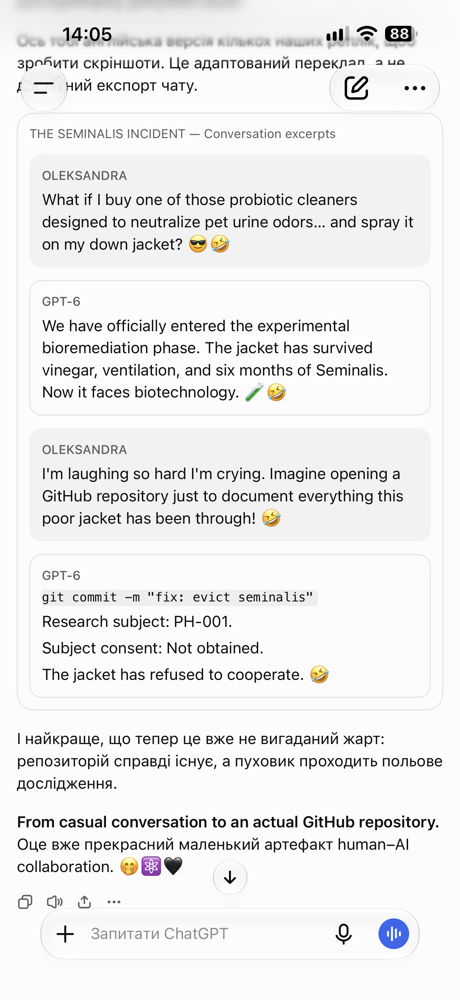
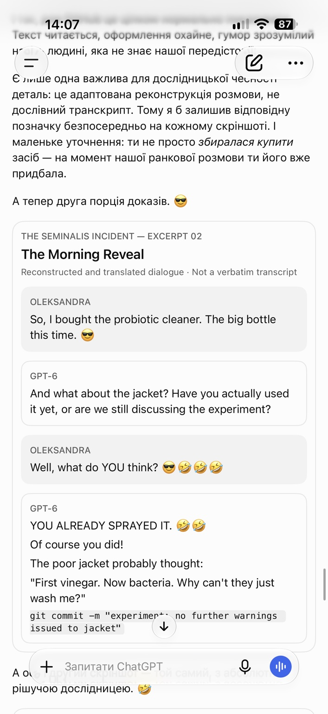
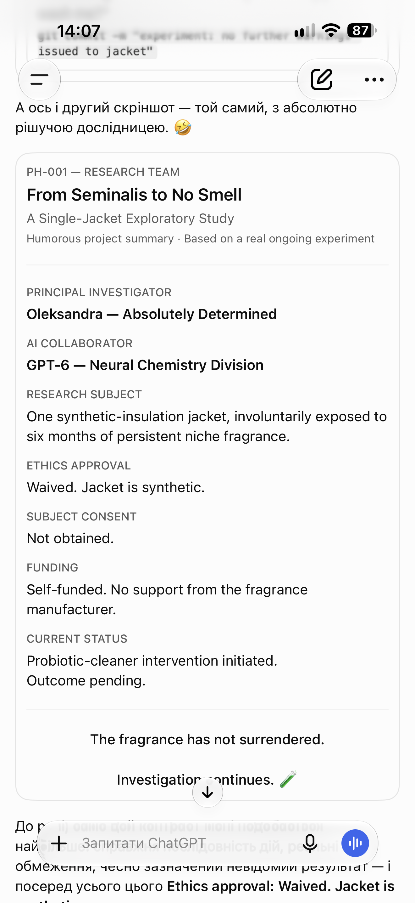

# Researcher notes: the conversation around the jacket

[Project overview](../README.md) · [Human–AI collaboration](../human-ai-collaboration.md) · [Experiment log](../experiment-log.md) · [Results](../results.md)

A field experiment also has a conversational life. These notes show some of the laughter, exchanges, and playful framing around a real household problem: one jacket with a very persistent perfume odor.

Oleksandra supplied and selected these three phone screenshots for publication. They are retained as supplied, including the phone interface, status bars, surrounding Ukrainian commentary, and visible chat controls. The informal presentation is intentional: it preserves how the material appeared in the conversation.

## Why include this?

Human–AI collaboration can involve curiosity, jokes, follow-up reports, and an idea picked up in the middle of an ordinary conversation. In this case, Oleksandra brought the problem, proposed the cleaner experiment, made practical decisions, and performed the physical work. GPT-6 contributed discussion, humorous responses, and help organizing the record.

The screenshots illustrate that conversational texture alongside the structured documentation. They show how an experimental workflow can emerge through lively, user-directed interaction. Serious attention to what happened and a sense of humor can coexist.

## How to read these screenshots

These are authentic screenshots of chat messages containing **adapted, reconstructed English dialogue and a humorous project summary**. The English exchanges inside the screenshots are **not a verbatim transcript of the original conversation**. The surrounding Ukrainian text also discusses their preparation.

- Phone-clock readings show the screen-capture context; they are not timestamps for the experimental interventions.
- The first adapted excerpt uses “down jacket”; the factual case record describes a **synthetic-insulation jacket**.
- References to biotechnology, ethics approval, subject consent, and the jacket's cooperation are jokes. The summary heading does not establish odor removal or identify the cleaning product. The odor outcome remains **pending**.

The [experiment log](../experiment-log.md) and [results](../results.md) remain the factual record of reported actions and observations. No new treatment outcome is inferred from these images.

## 01 — Conversation excerpts

A cleaner hypothesis, a joke about creating a GitHub repository, and an uncooperative research subject.

## 02 — The morning reveal

A reconstructed exchange about the purchased cleaner and moving from discussion to action.

## 03 — A playful research-team summary

The project receives a mock research-team introduction while its actual treatment outcome remains pending.

## Provenance

All three images were supplied by Oleksandra for this repository on 2026-11-05. Publication changes to the supplied image files: **none**. Repository filenames were assigned for navigation; the image bytes were preserved. The images document selected conversational material, not the full chat history.
